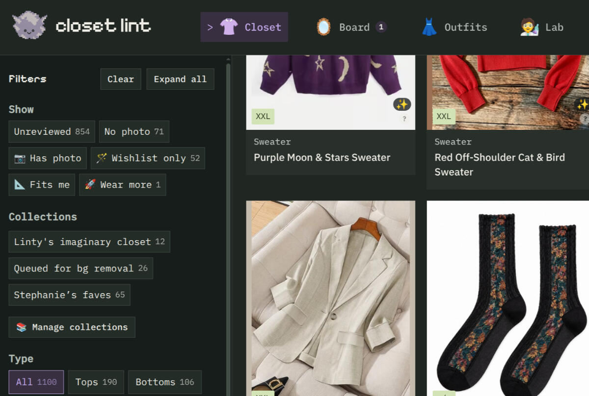

# Closet Lint

**A wardrobe goblin who lives in your closet and knows where everything is.**

Closet Lint is a personal wardrobe app for shopping your closet like a store where you already own everything. Organize your pieces, put outfits together, and plan what to wear, all in your browser. Settle wishlist battles, discover your wardrobe’s personality through your Style Sky, and see which pieces you wear most. It’s free, with no account or subscription.



> **Latest release: [Closet Lint 0.4.0](https://github.com/stephthegeek/closetlint/releases/tag/v0.4.0).** See the [release notes](docs/RELEASE-NOTES.md).

## What's included

- 👚 **My closet:** pieces and wishlist finds, with photos, tags, filters, and collections.
- 🪞 **Outfit board:** arrange pieces, save outfits, and return to unfinished drafts.
- 👗 **Outfits and calendar:** log what you wore, schedule saved outfits, or build an outfit for a future date.
- 🧑‍🔬 **Outfit Lab:** rate combinations, save favorites, and explore the patterns behind My taste.
- 🌌 **Your Style Sky:** wardrobe constellations, Sun, Moon, and Rising readings, and shareable chart images.
- 🪬 **Linty’s daily fortune card:** optional daily readings, wardrobe nudges, and color omens.
- 🏆 **Wishlist ranking:** keep your own order, with compatibility and similarity evidence from your closet, Lab ratings, and wear history.
- 🧳 **Trips:** plan daily outfits, save unfinished trips, track packing, and export a checklist. See [trips and packing](docs/USING-CLOSET-LINT.md#trips-and-packing).
- 🧺 **Laundry and care:** manually mark pieces that need cleaning, save care instructions, and keep photos of care labels.
- 🗄️ **Storage:** organize stored pieces, print bin labels, and make pull lists.
- 🤖 **Bring Your Own AI Assistant:** use your own AI assistant to prepare pieces from order emails, links, documents, or photos. Review a prepared import file, or use direct import with an assistant that can access your installation. See [AI assistant imports](docs/AI-ASSISTANT.md#ai-assistant-imports).
- 🔮 **Ask the Oracle:** take a wardrobe summary, question, and optional photos to your own AI assistant.
- 📷 **Photo tools:** multiple views, cropping, optional background removal, and individual photos created from multipack images with your AI assistant, with originals kept and results reviewed before saving.
- 💾 **Backup and restore:** keep your wardrobe data and photos together.
- 🎨 **Themes:** three themes, each with light and dark modes.

AI is optional: you can add pieces and use the core app without an AI assistant. For AI help, start with **Add → Bulk import pieces**. Closet Lint does not connect to your email or AI account; your assistant handles any access it needs.

## Get started

You'll need Python 3.10 or newer (check with `python3 --version`, or `py -3 --version` on Windows) and a web browser.

1. Download and unzip the release package.
2. Open a terminal in its folder and run the command for your computer:

   **Linux or macOS**

   ```bash
   python3 runtime/server.py --data ../closet-lint
   ```

   **Windows**

   ```powershell
   py -3 runtime\server.py --data ..\closet-lint
   ```

   This keeps your wardrobe in a `closet-lint` folder next to the app folder, so it stays separate from the app files. Keep the extracted app folder’s own name. If you already have a wardrobe, continue using its existing `--data` path.
3. Open http://127.0.0.1:6684/ in your browser and follow the setup prompts.

Keep the terminal open while you use the app; closing it stops the server.

The [Getting started guide](docs/GETTING-STARTED.md) covers setup, phone access on home Wi-Fi, a sample wardrobe, and updates. See [Using Closet Lint](docs/USING-CLOSET-LINT.md) for everyday features.

For access away from home, read the [experimental hosting notes](docs/WEB-HOSTING.md). Hosting requires separate HTTPS, password protection, and backups. The current adapter has provider limitations; it is not yet a generally supported installation option. Local installation still needs only Python and a browser.

Time to give Linty something to rummage through.

## A few things to know

- **Keep your installation private.** Closet Lint has no built-in login. Anyone who can reach an unprotected installation can view and edit its wardrobe. Use the local server only on your computer or a trusted home network; do not expose it directly to the internet or forward its port on your router. A hosted installation needs separate site-wide password protection, as described in the hosting notes. The public demos work differently: visitor changes stay in their own browser.
- **Photo tools are optional and have their own setup.** Run `python3 tools/check_setup.py --data ../closet-lint` for readiness checks and next steps (on Windows, use `py -3`). Background removal needs additional setup. Fine details can get lost, and it won't remove a person wearing the garment. You choose which results to keep.
- **Suggestions aren't guarantees.** Outfit combinations, fit labels, and packing lists still need your judgment.
- **Back up before updating.** Choose **Menu → Utilities → Export backup**, and keep your wardrobe data folder separate from the app folder.

## Testing, accessibility, and security

Installation and recovery have been checked on Linux. Windows and macOS installation are unverified so far; if you try either, an issue saying how it went is welcome.

Verification limits are recorded in [testing](CONTRIBUTING.md#testing) and the [security review](docs/archive/DEVELOPMENT-RECORDS.md#security-review-records). There has not been an independent human security audit.

The [accessibility review](CONTRIBUTING.md#accessibility) records keyboard, contrast, and screen reader improvements, ongoing automated checks, and remaining manual review. Full accessibility conformance has not been established.

## Feedback

Found a bug? [Open an issue](https://github.com/stephthegeek/closetlint/issues). For security problems, please use [private vulnerability reporting](https://github.com/stephthegeek/closetlint/security/advisories/new) instead of a public issue.

## Credits and license

[](https://vibecoded.fyi/)

Created by stephthegeek, with substantial AI assistance. Code, documentation, and Linty artwork are GPL-3.0-or-later. Third-party components retain their own licenses; see [NOTICE](NOTICE). Your wardrobe data and photos remain yours.
