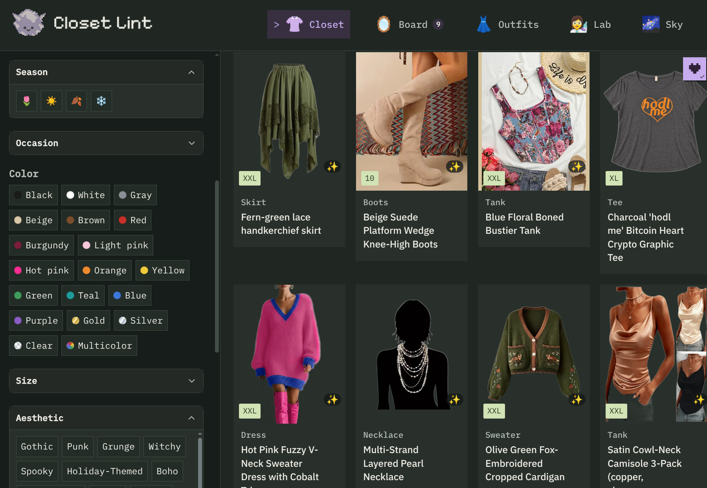

# Closet Lint

**A wardrobe goblin who lives in your closet and knows where everything is.**

Closet Lint is a personal wardrobe app for shopping your closet like a store where you already own everything. Organize your pieces, put outfits together, and plan what to wear, all in your browser. See your month of outfits in color, settle wishlist battles, and discover your wardrobe’s personality through your style Sky. It’s free, with no account or subscription.



> **Latest release: [Closet Lint 0.5.0](https://github.com/stephthegeek/closetlint/releases/tag/v0.5.0).** See the [release notes](docs/RELEASE-NOTES.md).

## What's included

### Organize your wardrobe

- 👚 **My closet:** a searchable wardrobe of pieces and wishlist finds, organized with photos, tags, and collections.
- 🧺 **Laundry and care:** track what needs cleaning and keep care instructions with each piece.
- 🗄️ **Storage:** find what’s packed away with bin labels and pull lists.
- 📷 **Photo tools:** multiple views, cropping, and optional background removal.

### Put outfits together and plan ahead

- 🪞 **Outfit board:** style your own pieces into outfit collages, from everyday looks to elaborate moodboards.
- 🧑‍🔬 **Outfit Lab:** experiment with fresh combinations and unexpected pairings from your closet, suited to your taste, season, and occasion.
- 👗 **Outfits and schedule:** a calendar for what you wore and what you plan to wear.
- 🧳 **Trips:** daily outfit planning and packing checklists built from your wardrobe.
- 🏆 **Wishlist ranking:** evidence-based comparisons of potential purchases, drawing on your preferences, wear history, and what works with your closet.

### Explore what feels like you

- 📖 **My almanac:** see your month in color through a beautiful calendar of the outfits you wore, with wardrobe highlights, upcoming plans, and optional local sky and weather.
- 😶‍🌫️ **Comfort zone:** eight fun, short quizzes that help shape wishlist rankings and Outfit Lab ideas around your preferences.
- 🌌 **Your Sky:** wardrobe constellations, Sun, Moon, and Rising readings, and shareable charts. Explore styles related to your own closet.
- 🪬 **Linty’s daily fortune card:** daily readings, wardrobe nudges, and color omens.

### Make it your own

- 🎨 **Themes:** three distinct looks, each with light and dark modes.
- 👚 **Icons and categories:** masc, femme, and gender neutral icon packs, plus customizable clothing categories to suit your wardrobe.

### Optional: Bring Your Own AI Assistant

Use an AI assistant such as Claude or ChatGPT. Free chats with file support can generate files for you to upload into Closet Lint. For more automation, use an assistant with approved access to your computer or server; paid subscriptions can provide additional tools and higher usage limits.

- 📥 **Bulk imports:** turn order emails, links, documents, or photos into wardrobe entries.
- 🔮 **Ask the Oracle:** explore outfit ideas, shopping decisions, and style questions using context from your closet.
- 🏷️ **Tidy titles & tags:** get help naming and categorizing your pieces.
- 📷 **Product photos:** create individual product photos, including separate images for pieces in multipacks.

See [AI assistant imports](docs/AI-ASSISTANT.md#ai-assistant-imports) and [Ask the Oracle](docs/AI-ASSISTANT.md#ask-the-oracle). Closet Lint does not connect to your email or AI account; your assistant handles any access it needs.

## Get started

You'll need Python 3.10 or newer (check with `python3 --version`, or `py -3 --version` on Windows) and a web browser.

1. Download and unzip the release package.
2. Open a terminal in its folder and run the command for your computer:

   **Linux or macOS**

   ```bash
   python3 runtime/server.py --data ../closet-lint
   ```

   **Windows**

   ```powershell
   py -3 runtime\server.py --data ..\closet-lint
   ```

   This keeps your wardrobe in a `closet-lint` folder next to the app folder, so it stays separate from the app files. Keep the extracted app folder’s own name. If you already have a wardrobe, continue using its existing `--data` path.
3. Open http://127.0.0.1:6684/ in your browser and follow the setup prompts.

Keep the terminal open while you use the app; closing it stops the server.

Docker users can use the [Docker installation](docs/GETTING-STARTED.md#run-with-docker), which includes Python and photo libraries.

The [Getting started guide](docs/GETTING-STARTED.md) covers setup, phone access on home Wi-Fi, a sample wardrobe, and updates. See [Using Closet Lint](docs/USING-CLOSET-LINT.md) for everyday features.

For access away from home, read the [experimental hosting notes](docs/WEB-HOSTING.md). Hosting requires separate HTTPS, password protection, and backups. The current adapter has provider limitations; it is not yet a generally supported installation option. Local installation still needs only Python and a browser.

Time to give Linty something to rummage through.

## A few things to know

- **Keep your installation private.** Closet Lint has no built-in login. Anyone who can reach an unprotected installation can view and edit its wardrobe. Use the local server only on your computer or a trusted home network; do not expose it directly to the internet or forward its port on your router. A hosted installation needs separate site-wide password protection, as described in the hosting notes. The public demos work differently: visitor changes stay in their own browser.
- **Photo tools are optional and have their own setup.** Run `python3 tools/check_setup.py --data ../closet-lint` for readiness checks and next steps (on Windows, use `py -3`). Background removal needs additional setup. Fine details can get lost, and it won't remove a person wearing the garment. You choose which results to keep.
- **Suggestions aren't guarantees.** Outfit combinations, fit labels, and packing lists still need your judgment.
- **Back up before updating.** Choose **Menu → Utilities → Export backup**, and keep your wardrobe data folder separate from the app folder.

## Testing, accessibility, and security

Installation and recovery have been checked on Linux. Windows and macOS installation are unverified so far; if you try either, an issue saying how it went is welcome.

Verification limits are recorded in [testing](CONTRIBUTING.md#testing) and the [security review](docs/archive/DEVELOPMENT-RECORDS.md#security-review-records). There has not been an independent human security audit.

The [accessibility review](CONTRIBUTING.md#accessibility) records keyboard, contrast, and screen reader improvements, ongoing automated checks, and remaining manual review. Full accessibility conformance has not been established.

## Feedback

Found a bug? [Open an issue](https://github.com/stephthegeek/closetlint/issues). For security problems, please use [private vulnerability reporting](https://github.com/stephthegeek/closetlint/security/advisories/new) instead of a public issue.

## Credits and license

[](https://vibecoded.fyi/)

Created by stephthegeek, with substantial AI assistance. Code, documentation, and Linty artwork are GPL-3.0-or-later. Third-party components retain their own licenses; see [NOTICE](NOTICE). Your wardrobe data and photos remain yours.
