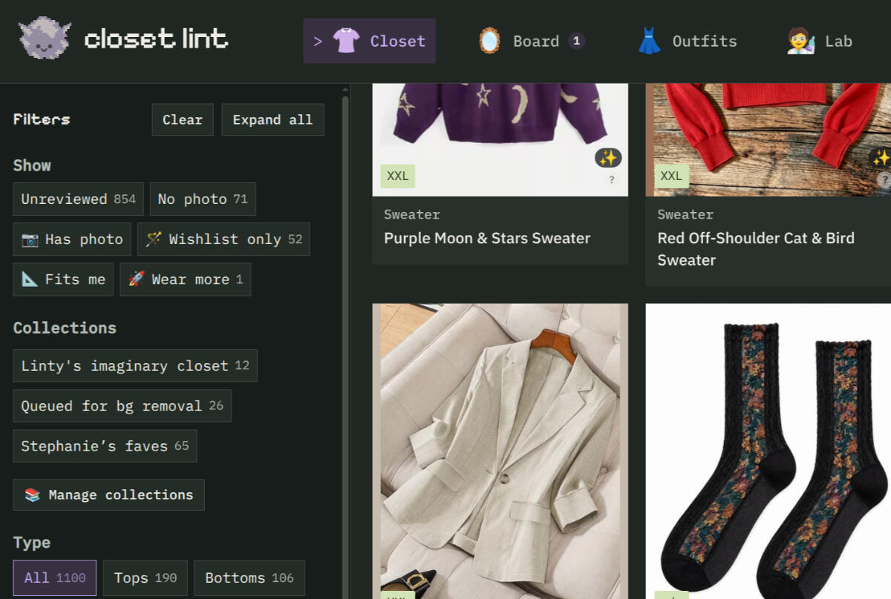

# Closet Lint

**A wardrobe goblin who lives in your closet and knows where everything is.**

Closet Lint is a personal wardrobe app for shopping your closet like a store where you already own everything. It opens in your browser and runs on your own computer by default. No account, no subscription, no sync, no telemetry: your wardrobe and photos stay with you.



> **Latest published release: [Closet Lint 0.3.0](https://github.com/stephthegeek/closetlint/releases/tag/v0.3.0).** This checkout also includes unreleased development changes. The features below describe this source version; see the [0.3 release notes](docs/RELEASE-NOTES.md) for what is in the published download.

## What's included

- 👚 **Your closet:** pieces and wishlist finds, with photos, tags, filters, and collections.
- 🪞 **Outfit board:** arrange pieces, save outfits, and return to unfinished drafts.
- 👗 **Outfits and calendar:** log what you wore, schedule saved outfits, or build an outfit for a future date.
- 🧑‍🔬 **Outfit Lab:** rate combinations, save favorites, and explore the patterns behind My taste.
- 🌌 **Your Style Sky:** wardrobe constellations, Sun, Moon, and Rising readings, and shareable chart images.
- 🪬 **Linty’s daily fortune card:** optional daily readings, wardrobe nudges, and color omens.
- 🏆 **Wishlist ranking:** keep your own order, with compatibility and similarity evidence from your closet, Lab ratings, and wear history.
- 🧳 **Trips:** save plans as you go, track packing, and export a checklist for print/PDF or Markdown, with optional outfit combinations.
- 🧺 **Laundry and care:** manually mark pieces that need cleaning, save care instructions, and keep photos of care labels.
- 🗄️ **Storage:** organize stored pieces, print bin labels, and make pull lists.
- 🤖 **Bring Your Own AI Assistant:** use your own AI assistant to import order emails, links, documents, or photos. Save directly with local Codex or Claude Code, or review an import file from a chat conversation. Upload sources in Closet Lint, request supported tags, and optionally separate multipacks or create individual product photos when your assistant has image tools. See [assistant imports](docs/ASSISTANT-IMPORT.md).
- 🔮 **Ask the Oracle:** take a wardrobe summary, question, and optional photos to your own AI assistant.
- 📷 **Photo tools:** optional local background removal, with originals kept and results reviewed before saving.
- 💾 **Backup and restore:** keep your wardrobe data and photos together.
- 🎨 **Themes:** three themes, each with light and dark modes.

AI is optional: you can add pieces and use the core app without an assistant. For direct imports, start with **Add → Bulk import pieces → Set up direct import**. Closet Lint does not connect to your email or AI account; your assistant handles any access it needs.

## Get started

You'll need Python 3.10 or newer (check with `python3 --version`, or `py -3 --version` on Windows) and a web browser.

1. Download and unzip the release package.
2. Open a terminal in its folder and run the command for your computer:

   **Linux or macOS**

   ```bash
   python3 runtime/server.py --data ../closet-lint
   ```

   **Windows**

   ```powershell
   py -3 runtime\server.py --data ..\closet-lint
   ```

   This keeps your wardrobe in a `closet-lint` folder next to the app folder, so it stays separate from the app files. Keep the extracted app folder’s own name. If you already have a wardrobe, continue using its existing `--data` path.
3. Open http://127.0.0.1:6684/ in your browser and follow the setup prompts.

Keep the terminal open while you use the app; closing it stops the server.

The [installation guide](docs/INSTALL.md) explains how to open the app from other devices on your home network, such as your phone or another computer, and how to load 12 sample pieces if you'd like to try things out first.

For access away from home, read the [experimental hosting notes](docs/HOSTING.md). Hosting requires separate HTTPS, password protection, and backups. The current adapter has provider limitations; it is not yet a generally supported installation option. Local installation still needs only Python and a browser.

Time to give Linty something to rummage through.

## A few things to know

- **Keep your installation private.** Closet Lint has no built-in login. Anyone who can reach an unprotected installation can view and edit its wardrobe. Use the local server only on your computer or a trusted home network; do not expose it directly to the internet or forward its port on your router. A hosted installation needs separate site-wide password protection, as described in the hosting notes. The public demos work differently: visitor changes stay in their own browser.
- **Photo tools are optional and have their own setup.** Run `python3 tools/check_setup.py --data ../closet-lint` for readiness checks and next steps (on Windows, use `py -3`). Background removal needs additional setup. Fine details can get lost, and it won't remove a person wearing the garment. You choose which results to keep.
- **Suggestions aren't guarantees.** Outfit combinations, fit labels, and packing lists still need your judgment.
- **Back up before updating.** Choose **Menu → Utilities → Export backup**, and keep your wardrobe data folder separate from the app folder.

## Testing and security

Installation and recovery have been checked on Linux. Windows and macOS installation are unverified so far; if you try either, an issue saying how it went is welcome.

Automated tests and security reviews cover the behaviors described in the [testing guide](docs/TESTING.md) and [security review](docs/SECURITY-REVIEW.md). Those records identify the builds checked and the remaining limits; they are not a guarantee for every development checkout. There has not been an independent human security audit.

## Feedback

Found a bug? [Open an issue](https://github.com/stephthegeek/closetlint/issues). For security problems, please use [private vulnerability reporting](https://github.com/stephthegeek/closetlint/security/advisories/new) instead of a public issue.

## Credits and license

[](https://vibecoded.fyi/)

Created by stephthegeek, with substantial AI assistance. Code, documentation, and Linty artwork are GPL-3.0-or-later. Third-party components retain their own licenses; see [NOTICE](NOTICE). Your wardrobe data and photos remain yours.

Read the [0.3 release notes](docs/RELEASE-NOTES.md) for the current release scope.
